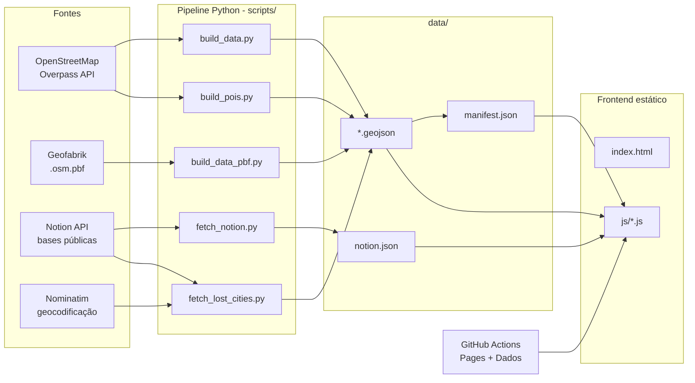
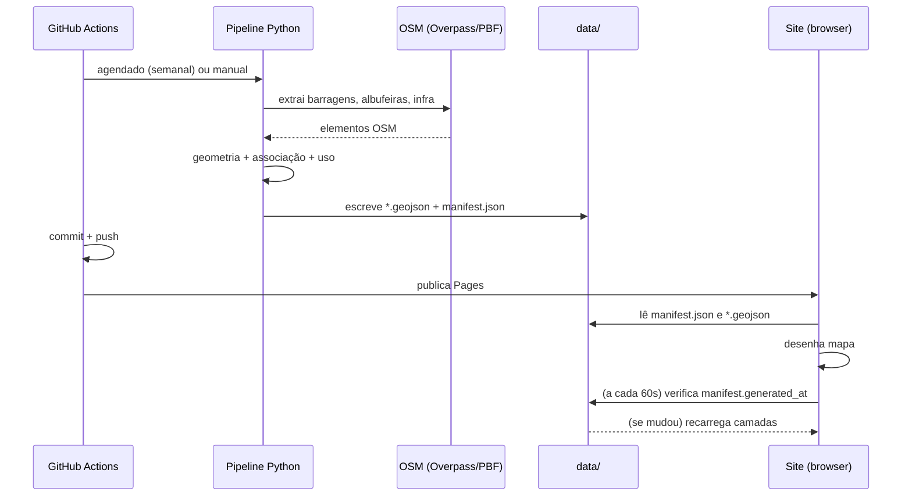

# 01 — Arquitetura

## 1. Visão geral

O projeto tem duas metades bem separadas:

1. **Pipeline de dados (offline, Python)** — extrai do OpenStreetMap, associa e
   classifica, e escreve ficheiros estáticos leves em `data/`.
2. **Frontend (estático, JavaScript)** — lê apenas esses ficheiros e desenha o
   mapa. **Não faz chamadas à Overpass a partir do browser.**

Tudo o resto (automação, publicação, integração Notion) serve para que os dados
em `data/` estejam sempre atualizados sem intervenção manual.

## 2. Stack técnica

| Camada | Tecnologia |
| --- | --- |
| Mapa | [MapLibre GL JS](https://maplibre.org) 4.7.1 (CDN: `unpkg.com`) |
| Mapa base | [OpenFreeMap](https://openfreemap.org) — estilos `positron` (claro) e `dark` |
| Relevo | Terrain Tiles (AWS/Mapzen, `elevation-tiles-prod`, codificação *terrarium*); curvas de nível geradas no browser com [`maplibre-contour`](https://github.com/onthegomap/maplibre-contour) |
| Frontend | HTML5 + CSS3 + JavaScript vanilla (módulos ES), **sem build** |
| Tipografia | *Fraunces* (títulos) + *Inter* (UI), via Google Fonts |
| Dados | Python 3.10+; `shapely`, `pyproj` (principal), `osmium`/pyosmium (extracts `.pbf`) |
| Automação | GitHub Actions (workflows em `.github/workflows/`) |
| Publicação | GitHub Pages (artefacto estático) |

## 3. Componentes

### 3.1 Frontend (`index.html`, `js/`, `css/`)

Página única (`index.html`) que carrega `js/main.js` como módulo. Os módulos
dividem responsabilidades:

- `config.js` — configuração central (identidade, cores, camadas, limiares).
- `main.js` — arranque, tema, mapa, estado no URL, orquestração.
- `layers.js` — carregamento e estilo das camadas, filtros, seleção/destaques.
- `panel.js` — gaveta de camadas, filtros, legenda e "fichas" (detalhe).
- `search.js` — pesquisa (ignora acentos).
- `discover.js` — ecrã de boas-vindas e lista "No mapa".
- `utils.js` — utilidades (normalização, HTML seguro, distâncias geométricas).

Ver [04 — Frontend](04-frontend.md).

### 3.2 Pipeline de dados (`scripts/`)

- `config.py` — configuração central (endpoints, raios, tolerâncias, POIs).
- `build_data.py` — pipeline principal (Overpass) + utilitários partilhados.
- `build_data_pbf.py` — variante com extracts do Geofabrik (mais fiável).
- `overpass.py` — cliente Overpass com *retries*, *backoff* e espelhos.
- `geo.py` — conversões OSM → shapely e utilitários métricos.
- `fetch_notion.py` — liga barragens a páginas do Notion.
- `fetch_lost_cities.py` — aldeias submersas / bairros novos (base Notion).
- `build_pois.py` — geometria dos POIs curados (via API do OSM).

Ver [02 — Pipeline de dados](02-pipeline-dados.md).

### 3.3 Dados (`data/`)

Ficheiros estáticos consumidos pelo site:

- `manifest.json` — índice de camadas/contagens + metadados (data de geração,
  fonte, licença). É também a **memória da última extração boa**.
- `<camada>_<cc>.geojson` — uma camada por país (ex.: `dams_pt.geojson`).
- `<camada>.geojson` — camadas não divididas por país (ex.: `pois.geojson`,
  `submersos.geojson`).
- `notion.json` — mapa `dam_id → { url, titulo, foto_capa, resumo }`.

Ver [03 — Modelo de dados](03-modelo-dados.md).

## 4. Fluxo de dados (fim a fim)

## 5. Decisões de desenho

- **Site estático, sem backend.** Custo zero de operação, seguro e compatível
  com GitHub Pages. Todo o estado (view, barragem selecionada) vive no `hash`
  do URL.
- **Sem passo de build no frontend.** Módulos ES nativos; o que se edita é o que
  corre. Menos ferramentas, mais acessível a quem não é técnico.
- **Dados pré-computados.** A associação espacial caríssima (distâncias
  métricas com `shapely`) corre *offline*; o browser só recebe GeoJSON leve.
- **Dois caminhos de extração.** Overpass é simples mas instável; os extracts
  do Geofabrik (`.pbf`) são robustos e são o método usado pela automação.
- **Escrita por país.** Cada país tem os seus ficheiros; uma extração de um só
  país não toca nos do outro (comportamento de *merge* no `manifest`).
- **Validação "não apagar dados bons".** Se uma extração trouxer < 80 % das
  barragens anteriores, o build aborta sem commit (`MIN_DAMS_RATIO`).
- **ID estável derivado do OSM.** `dam_id = "tipo/id"` é a chave pública que
  liga o mapa ao Notion, independente da base de dados interna.
- **Camadas pesadas carregadas tarde.** Cada camada tem `minzoom`; as mais
  pesadas (rede elétrica, condutas) ficam desligadas por defeito e só aparecem
  em zoom alto.

## 6. Limites da arquitetura

- **Qualidade do OSM:** o *tagging* é inconsistente; há barragens sem nome,
  uso, altura ou operador.
- **Associação espacial heurística:** ligações por proximidade (200 m / 2 km /
  3 km) podem gerar falsos positivos em vales com várias infraestruturas.
- **Sem PMTiles (por agora):** as camadas são GeoJSON. Há um plano condicional
  para PMTiles se os tamanhos excederem o orçamento (ver `PROMPT_DEEPSEEK_v2.md`).
- **Clustering instável:** desligado por defeito (`CLUSTER.enabled = false`);
  a despoluição é feita por colocação anti-colisão dos ícones.
- **Capas do Notion expiram (~1 h):** para fotos estáveis é preciso usar URLs
  externas.
