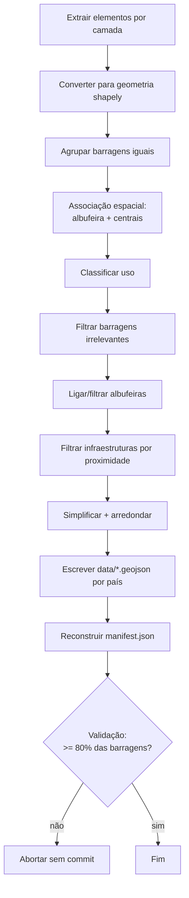
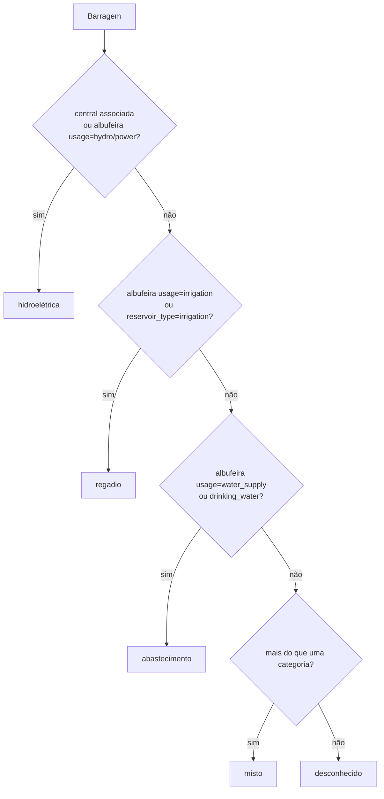

# 02 — Pipeline de dados

O pipeline transforma elementos do OpenStreetMap em GeoJSON leve para o site.
Há **dois caminhos** equivalentes, que produzem exatamente os mesmos ficheiros:

| Caminho | Script | Fonte | Uso |
| --- | --- | --- | --- |
| Overpass | `scripts/build_data.py` | Overpass API | local, dados pequenos/experimentais |
| Geofabrik (.pbf) | `scripts/build_data_pbf.py` | extract oficial do país | **usado pela automação** (fiável) |

O `build_data_pbf.py` **reutiliza** as funções de `build_data.py`
(associação, classificação de uso, escrita em `data/`).

## 1. Fluxo geral



## 2. Camadas extraídas

Definidas em `scripts/config.py` (`BASE_LAYERS` e `INFRA_LAYERS`).

### Camadas base (todo o país)

| Camada | Tags OSM |
| --- | --- |
| `dams` | `waterway=dam` |
| `weirs` | `waterway=weir` |
| `reservoirs` | `natural=water` + `water=reservoir`; `landuse=reservoir` |

### Camadas de infraestrutura (raio à volta das barragens)

| Camada | Tags OSM | Raio |
| --- | --- | --- |
| `plants` | `power=plant`/`generator` + `plant:source`/`generator:source` ∈ {`hydro`, `water`} | 3 km |
| `substations` | `power=substation` | 3 km |
| `power_lines` | `way[power=line]` | 3 km |
| `conduits` | `man_made=pipeline` + `substance=water`; `waterway` ∈ {`pressurised`, `canal`, `spillway`}; `lock=yes` | 3 km |

> No OSM a tag correta para hidroelétricas é `plant:source=hydro`; aceita-se
> também `water` por robustez.

## 3. Extração Overpass (`build_data.py`)

1. **Query por área** (`ql_area`): usa a área administrativa do país
   (`area["ISO3166-1"="PT"][admin_level=2]`).
2. **Query de infraestrutura** (`ql_around`): usa `around` em torno das
   barragens (e das centrais, para subestações e linhas).
3. **Fallback por subdivisões**: se a query por país der *timeout*, divide por
   distritos (PT, `admin_level=6`) ou comunidades autónomas (ES,
   `admin_level=4`) via `overpass.discover_subareas`.
4. **Infraestruturas**: vão sempre por subdivisões (a query `around` sobre
   todas as barragens do país é demasiado pesada para a Overpass pública).

O cliente `overpass.py` roda por **vários espelhos**, com **retries** e
**backoff exponencial** com *jitter*, e faz pausas entre pedidos (política de
uso). O `User-Agent` identificado é obrigatório (`config.USER_AGENT`).

### Modo offline (`--offline`)

Lê fixtures locais em `scripts/fixtures/<CC>_<camada>.json` (amostra pequena,
sem rede). Útil para testar o pipeline e o site sem tocar na internet.

## 4. Extração Geofabrik (`build_data_pbf.py`)

1. **Descarrega** o extract do país (`portugal-latest.osm.pbf`,
   `spain-latest.osm.pbf`) para cache (`/tmp/osm-cache`, ou `OSM_CACHE`).
2. **Processa** com `pyosmium` (`osmium.SimpleHandler`) filtrando em memória
   pelas mesmas tags.
3. **Índice de nós:** `OSM_IDX` controla o índice de localizações. Por omissão
   `flex_mem` (RAM); a automação usa `sparse_file_array,/tmp/osm-node.cache`
   (ficheiro) para poupar RAM em países grandes.

```bash
python scripts/build_data_pbf.py --countries PT          # Portugal
python scripts/build_data_pbf.py --countries PT,ES       # ambos
python scripts/build_data_pbf.py --countries PT --skip-infra
```

## 5. Agrupamento de barragens (`build_dams`)

Uma barragem pode aparecer como várias features OSM (linha + área + nó).

- Agrupa features a **≤ 300 m** cujo **nome normalizado coincide** (ou uma
  delas não tem nome), com *union-find* e um índice espacial `STRtree`.
- Escolhe a feature "primária" (com nome e mais tags) e junta as tags em falta.
- Guarda a melhor geometria (prioridade `relation > way > node`) e calcula um
  **ponto representativo** (`representative_point`, garantidamente dentro).
- `dam_id` = `"{osm_type}/{osm_id}"` da feature primária.
- `members` lista todos os `tipo/id` agrupados.

A normalização de nome remove acentos e prefixos comuns
("barragem de/da/do", "presa de/del", "embalse de/del").

## 6. Associação espacial e classificação (`associate`)

Para cada barragem calcula-se, em **coordenadas métricas** (EPSG:3035):

- **`reservoir_id`** — albufeira que interseta o ponto (buffer de 30 m) ou cuja
  distância ≤ `RESERVOIR_NEAR_M` (200 m); caso contrário, a mais próxima a
  ≤ `RESERVOIR_FALLBACK_M` (200 m). Guarda também `reservoir_name` e
  `reservoir_area_ha`.
- **`plant_ids`** — centrais hidroelétricas a ≤ `PLANT_NEAR_M` (2 km). Soma a
  potência máxima (`plant:output:electricity`/`generator:output:electricity`)
  em `plant_power_mw`.
- **`uso`** — classificação por prioridade:



  - Se várias categorias se aplicam → `misto`; nenhuma → `desconhecido`.
  - `uso_fonte` guarda a proveniência (ex.: `"albufeira (usage=power); central
    associada (4)"`) para transparência — mostrada em "Detalhes técnicos".

## 7. Filtragem

### Barragens (`filter_dams`)

Descarta barragens **sem nome**, **sem albufeira** e **sem central** associada
quando a estrutura é minúscula (< `MIN_DAM_SIZE_M`, 15 m) — tipicamente levadas
e pequenos açudes sem interesse.

### Albufeiras (`link_and_filter_reservoirs`)

Mantém só as **ligadas a uma barragem** (`dam_id`) **ou** com área
≥ `MIN_RESERVOIR_AREA_HA` (5 ha). Descarta charcas/tanques. Guarda `area_ha` e
o `dam_id` inverso na albufeira.

### Infraestruturas

Subestações, linhas e condutas são filtradas para ficar só o que está a
≤ 3 km de uma barragem (índice `STRtree`).

## 8. Simplificação e escrita

- **Simplificação** Douglas–Peucker em metros, por camada
  (`SIMPLIFY_TOLERANCE_M`): ex. albufeiras 20 m, linhas elétricas 40 m,
  condutas 30 m; 0 = sem simplificação (pontos).
- **Arredondamento** das coordenadas a 5 casas (`COORD_DECIMALS`, ~1 m).
- **Geometrias degeneradas** (área/comprimento ~0 após arredondar) são
  descartadas (`MIN_AREA_M2`, `MIN_LEN_M`) — o MapLibre não gosta de área zero.
- **Escrita por país** (`write_layer`): cada país no seu ficheiro
  `<camada>_<cc>.geojson`; ficheiros dos países processados são reescritos, os
  restantes ficam intactos. Um ficheiro legado `<camada>.geojson` é removido.

`manifest.json` é reconstruído a partir do disco (`rebuild_manifest`), o que
preserva os ficheiros do outro país (*merge*). Também se pode forçar só a
reconstrução com `python scripts/build_data.py --manifest-only`.

## 9. Validação "não apagar dados bons"

Depois de escrever, o build compara o total de barragens com o manifest
anterior (`LAST_GOOD_FILE = data/manifest.json`):

- Se a extração **não trouxer nenhuma barragem** → aborta.
- Se trouxer **< 80 %** das anteriores (`MIN_DAMS_RATIO`) → aborta sem commit.
- `--force` ignora esta validação.

Como o commit é feito depois e por país, uma falha deixa os dados bons
intactos.

## 10. Scripts auxiliares

### `fetch_notion.py`

Lê a base de barragens do Notion (API oficial) e gera `data/notion.json`.
Normaliza o campo `ID Mapa` (aceita `way/123`, `way 123` ou URL do OSM),
converte o URL interno para público e deteta IDs inválidos/duplicados.
Sem token, termina sem erro (o site fica sem links). Ver
[06 — Integração Notion](06-notion.md).

### `fetch_lost_cities.py`

Integra a base de investigação **"Lost Cities - BD"**: seleciona registos
*Aldeia Submersa* / *Bairro*, associa cada um à sua barragem-mãe
(`Related Lost Cities - BD`) e **geocodifica** o campo `Coordenadas`
(Nominatim/OSM, ≤ 1 pedido/s, com cache em `scripts/geocode_cache.json`).
Quando a geocodificação é fraca, **ancora** o ponto na barragem-mãe e escreve
uma `ressalva`. Gera `data/submersos_notion.geojson` e
`data/bairros_notion.geojson` e atualiza o manifest (sem depender de `shapely`).

### `build_pois.py`

Obtém a geometria real dos POIs curados (lista `POIS` em `config.py`) via
**API do OSM** (`/{tipo}/{id}/full`, sem Overpass) e escreve `data/pois.geojson`.

### `push_notion_osm.py` (escrita no Notion)

Primeiro script que **escreve** no Notion: preenche a coluna `OSM` de cada
página da base de barragens com o `dam_id` (ex. `way/107571431`). Corre em
ensaio (`--dry-run`) por omissão; `--apply` escreve. Ver
[06 — Integração Notion](06-notion.md#4-escrita-opcional-preencher-a-coluna-osm).

## 11. Execução local (resumo)

```bash
python -m venv .venv && source .venv/bin/activate
pip install -r requirements.txt

# Overpass (real) ou fixtures (offline)
python scripts/build_data.py
python scripts/build_data.py --offline

# Geofabrik (recomendado para PT+ES)
python scripts/build_data_pbf.py --countries PT,ES

# Ver o site
python -m http.server 8000   # http://localhost:8000
```

Ver [07 — Desenvolvimento](07-desenvolvimento.md) para detalhes.
