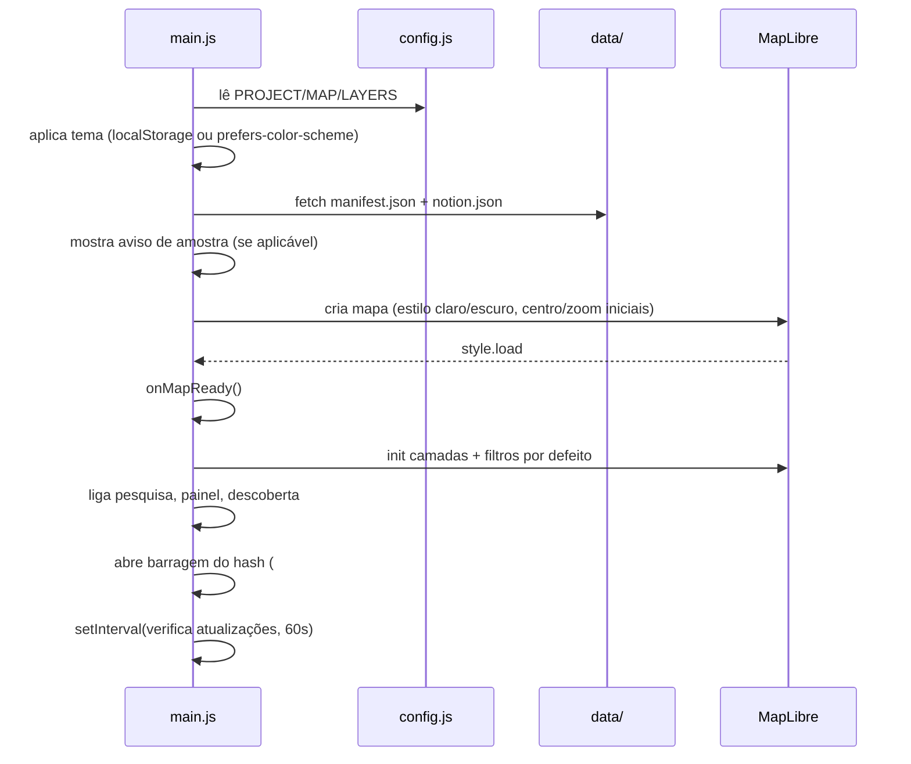
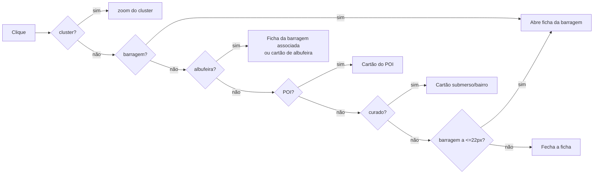

# 04 — Frontend

O site é **HTML + CSS + JavaScript vanilla** (módulos ES), sem framework e sem
passo de build. Carrega **MapLibre GL JS**, o **maplibre-contour** (curvas de
nível) e as fontes via CDN.

## 1. Estrutura

```
index.html        Markup: barra, gaveta, legenda, ficha, modais, mapa
css/style.css     Estilos (tokens em :root, modo escuro, responsivo)
js/main.js        Arranque, tema, mapa, estado no URL, orquestração
js/config.js      Configuração central
js/layers.js      Camadas, filtros, seleção/destaques
js/panel.js       Gaveta, filtros, legenda, fichas
js/search.js      Pesquisa (ignora acentos)
js/discover.js    Boas-vindas + lista "No mapa"
js/utils.js       Utilitários
```

## 2. Arranque (`main.js`)



Pontos-chave:

- **Tema**: guardado em `localStorage` (`STORAGE.theme`); alternativa ao
  `prefers-color-scheme`. Trocar de tema reescreve o estilo do mapa
  (`setStyle`) e reconstrói as camadas (`rebuildAfterStyleChange`).
- **Estado no URL** (`parseHash`/`writeHash`): `#map=z/lat/lon&dam=tipo/id`.
  Atualizado em `moveend`/`zoomend` e ao selecionar/fechar uma ficha. Torna o
  estado partilhável e recarregável.
- **Atualização automática**: a cada 60 s relê o `manifest.json`; se o
  `generated_at` mudou, recarrega `notion.json` e todas as camadas
  (`reloadData`).
- **`?debug=1`**: expõe o mapa em `window.__map`.

### Clique no mapa (prioridade)

Um único handler de clique resolve os alvos por ordem:



A regra "barragem mais próxima ≤ 22 px" (`nearestDam`) garante que os ícones
continuam clicáveis mesmo sobrepostos (substitui o clustering).

## 3. Camadas (`layers.js`)

### Modelo de camadas

Cada camada é descrita em `LAYERS` (`config.js`) com `key`, `label`, `kind`
(`dams`, `point`, `line`, `polygon`, `outline`, `poi`, `curated`), `minzoom`,
`default`, `color` e `legendSwatch`.

Estado interno (`state`): `loaded`, `loading`, `data`, `visible`, `filters`,
`selectedDam`, `selectedReservoir`, `selectedFid`, `hoverFid`, `fidByDam`,
`damByFid`.

### Carregamento

- `loadLayerData(key)` lê os ficheiros de `manifest.layers[key]` com
  `?v=<generated_at>` (invalidação de cache).
- Para `dams`: aplica o Notion (`attachNotion`), calcula tamanhos
  (`computeDamSizes` → `dsize` + `fid`) e constrói índices `dam_id ↔ fid`.
- `ensureLayer` é idempotente e protege contra carregamentos concorrentes.

### Estilos notáveis

- **Ícones de barragem**: um SVG por `uso`, rasterizado em canvas por
  `ensureDamIcons` (`damicon-<uso>`), dimensionado por `dsize`. Anel dourado
  para quem tem página Notion (camada `dams-notion`).
- **Mapa base atenuado** (`attenuateBaseMap`): baixa a opacidade de POIs e
  estradas secundárias do estilo do OpenFreeMap (heurística por id/tipo,
  defensiva).
- **Curvas de nível** (`addContours`): a biblioteca `maplibre-contour` (CDN em
  `index.html`) gera tiles vetoriais de isolinhas **no browser**, a partir das
  mesmas tiles de relevo Terrarium — sem servidor e sem ficheiros no repositório.
  Camadas `contours-lines` e `contours-labels` (cotas só nas linhas mestras, a
  partir de `labelMinzoom`); intervalo por zoom em `CONTOURS.thresholds`. Sem
  cotas negativas (batimetria): o mar fica limpo. Cores por tema.
- **Relevo** (`addHillshade`): camada `hillshade` sobre a mesma fonte de
  elevação — **desligada por omissão** (`HILLSHADE.enabled: false`).
- **Destaque da albufeira** (`buildReservoirHighlight`): source/layers próprios
  filtrados por `reservoir_id`.
- **Rede elétrica relacionada** (`buildRelatedHighlight`): `src-related` +
  halo/linha/ponto em âmbar.

### Filtros (`applyFilters`)

Aplicam-se às **barragens individuais** via `setFilter`:

- país (`country`), uso (`uso ∈ usos`) e "só com Notion" (`has notion_url`).
- O mesmo filtro replica-se aos contornos (`dam_geoms-*`).

### Seleção e destaques

- `selectDam(damId, reservoirId)`: marca `feature-state selected` (via `fid`),
  filtra o destaque da albufeira e **esbate a rede** (`dimNetwork`).
- `highlightRelated(dam)`: calcula, em memória, as centrais associadas, as
  linhas que lhes chegam (≤ 300 m) e as subestações nessas ligações (≤ 400 m),
  e desenha-as em `src-related`. Devolve nomes/contagens para a ficha.

### Reconstrução e recarga

- `rebuildAfterStyleChange()`: chamado após troca de tema; recria tudo a partir
  dos dados já em memória.
- `reloadData()`: remove tudo e recarrega do disco (usado na atualização
  automática).

## 4. Painel (`panel.js`)

- **Gaveta** com abas **"Camadas"** e **"No mapa"**, filtrável por país, uso e
  Notion; lista de camadas com *swatch* e `minzoom`.
- **Legenda** compacta e sempre visível (só categorias ativas).
- **Fichas** (bottom sheet em telemóvel, 3 posições: `collapsed`/`half`/`full`):
  - `showDetail` — ficha de barragem: capa (foto Notion ou *fallback* na cor do
    uso), chips (país/rio/uso), grelha de factos, botão **Ver no Notion**,
    **aldeias submersas e bairros ligados** (ligados por `dam_id`; se faltar,
    pelo nome da barragem-mãe), secção **Contribuir** (Copiar ID), `<details>`
    técnico e links OSM/Wikidata/Wikipédia.
  - `showReservoir`, `showPoi`, `showCurated` — cartões de albufeira, POI e
    povoado/bairro (com `confianca` e `ressalva`).
- `copyId` usa `navigator.clipboard` com *fallback* para `<textarea>`.

## 5. Pesquisa (`search.js`)

- Índice construído a partir das barragens (nome, `name_pt`, `name_es`, **rio**)
  e das albufeiras (nome/`name_pt`/`name_es`).
- Compara texto **normalizado** (sem acentos, minúsculas).
- Pontuação: igual (0) < começa-por (1) < contém (2); desempata por nome.
- Limite de 12 resultados, navegação por teclado (↑/↓/Enter/Esc).

## 6. Descoberta (`discover.js`)

- **Boas-vindas** (primeira visita, recordada em `localStorage`; reabrível pelo
  botão "?"): nome/subtítulo, contadores por país (via `counts_by_country`) e
  destaques clicáveis (`FEATURED`, localizados por nome ou `id`).
- **Lista "No mapa"**: barragens no *viewport* (atualiza em `moveend`, com
  debounce), ordenável por nome/altura/ano/potência, limitada a **200** itens
  com aviso "aproxima para ver mais". Clicar/hover sincroniza com o mapa.

## 7. Utilitários (`utils.js`)

`normalize` (sem acentos) · `escapeHtml` (segurança de texto OSM/Notion) ·
`fmtNumber` (`pt-PT`) · `debounce` · `fetchJson` (com fallback) ·
`distanceM` / `segmentDistanceM` / `distanceToGeometryM` / `pointOf`
(geometria aproximada para o destaque da rede).

## 8. Interface e identidade

- **Nome**: *Águas Represadas* (`PROJECT.name`, fácil de trocar).
- **Tipografia**: *Fraunces* (títulos) + *Inter* (UI).
- **Paleta**: betão/água/xisto/granito em tokens CSS (`:root`) com modo escuro.
  Cores de uso escolhidas para contraste AA e distinção em deuteranopia.
- **Responsivo**: gaveta em ecrã inteiro e ficha em *bottom sheet* em ecrãs
  < 780 px; alvos de toque ≥ 44 px; `prefers-reduced-motion` respeitado.
- **Acessibilidade**: `aria-*`, foco visível, `aria-live` na ficha.

## 9. Onde mudar

| Quero mudar… | Ficheiro / constante |
| --- | --- |
| Nome/subtítulo | `js/config.js` → `PROJECT` |
| Centro/zoom, estilos do mapa base | `js/config.js` → `MAP` |
| Cores de uso / confiança | `js/config.js` → `USO_COLORS`, `CONFIANCA_COLORS` |
| Camadas, `minzoom`, visibilidade inicial | `js/config.js` → `LAYERS` |
| Relevo/hillshade (ligar/desligar, exagero) | `js/config.js` → `HILLSHADE` |
| Curvas de nível (intervalos por zoom, cores, opacidade) | `js/config.js` → `CONTOURS` |
| Clustering | `js/config.js` → `CLUSTER.enabled` |
| Destaques (boas-vindas) | `js/config.js` → `FEATURED` |
| Tamanho/raios da rede relacionada | `js/config.js` → `DAM_ICON`, `RELATED` |
| Cores/superfícies/tipografia | `css/style.css` (`:root` e `[data-theme="dark"]`) |
