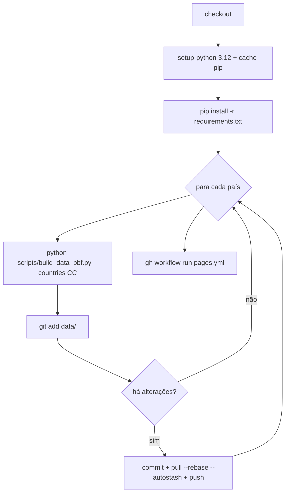

# 05 — Automação (GitHub Actions)

Há quatro workflows em `.github/workflows/`. Todos precisam de
*Settings → Actions* ativo e, para o Pages, da fonte definida como
**GitHub Actions** (*Settings → Pages*).

| Workflow | Ficheiro | Quando corre | O que faz |
| --- | --- | --- | --- |
| **Dados OSM (semanal)** | `data.yml` | segundas, 04:17 UTC + manual | Regenera `data/*.geojson` a partir dos `.pbf` do Geofabrik, país a país |
| **Dados Notion (manual)** | `notion.yml` | **só manual** | Atualiza `notion.json` e as camadas `submersos`/`bairros` |
| **Publicar no GitHub Pages** | `pages.yml` | `push` em `main` + manual | Publica o site estático |
| **Pré-preencher OSM (manual)** | `notion_osm.yml` | **só manual** | Preenche a coluna `OSM` das páginas de barragem (ensaio por omissão) |

## 1. `data.yml` — Dados OSM (semanal)

Detalhes:

- **`workflow_dispatch`** permite escolher `countries` (ex.: `ES`).
- **Concorrência**: `group: dados-osm`, `cancel-in-progress: false` (não
  interrompe uma extração a meio).
- **`timeout-minutes: 120`** e **`OSM_IDX: sparse_file_array,/tmp/osm-node.cache`**
  (índice de nós em ficheiro → muito menos RAM, essencial para Espanha ~1,5 GB).
- **Commit por país**: cada país é commitado logo que termina, para o site ir
  mostrando os dados à medida que ficam prontos (o site recarrega a cada 60 s).
- **Falha de um país não afeta o outro**: o país que falhar não é commitado,
  mantendo-se os dados bons anteriores.
- **Disparo explícito do Pages**: commits feitos com o `GITHUB_TOKEN` **não**
  disparam outros workflows, por isso o passo final corre
  `gh workflow run pages.yml --ref main`.
- **Permissões**: `contents: write` e `actions: write` (para disparar o deploy).

## 2. `notion.yml` — Dados Notion (manual)

- Corre `fetch_notion.py` e `fetch_lost_cities.py` com os segredos
  `NOTION_TOKEN` e `NOTION_DATABASE_ID` (variáveis de ambiente).
- Faz commit de `data/notion.json`, `data/manifest.json`,
  `data/submersos_notion.geojson`, `data/bairros_notion.geojson` e
  `scripts/geocode_cache.json` (quando há alterações).
- No fim, dispara o Pages (mesma razão do `data.yml`).
- **Sem segredos, não falha**: os scripts terminam sem erro e o site fica sem
  links (a ausência de token é detetada e registada).

> **Fotos do Notion:** capas carregadas *no* Notion expiram (~1 h); correr este
> workflow mais vezes **não resolve** isso — o estável é usar **URLs externas**.

## 3. `pages.yml` — Publicar no GitHub Pages

- `on: push` em `main` + `workflow_dispatch`.
- `build`: `actions/configure-pages` + `actions/upload-pages-artifact` com
  `path: .` (todo o repositório é o artefacto estático).
- `deploy`: `actions/deploy-pages` no ambiente `github-pages`.
- **Concorrência**: `group: pages`, `cancel-in-progress: true`.
- **Permissões**: `contents: read`, `pages: write`, `id-token: write`.

## 4. Variáveis de ambiente e segredos

| Nome | Onde | Uso |
| --- | --- | --- |
| `NOTION_TOKEN` | Secret do repositório | Token da integração Notion |
| `NOTION_DATABASE_ID` | Secret do repositório | Base de barragens (e, para `fetch_lost_cities`, a base "Lost Cities - BD") |
| `OSM_IDX` | Env do `data.yml` | Índice de nós do pyosmium (`sparse_file_array,…`) |
| `OSM_CACHE` | Opcional (local) | Diretório de cache dos `.pbf` (por omissão `/tmp/osm-cache`) |
| `NOTION_PUBLIC_DOMAIN` | Opcional | Domínio para converter URLs internas do Notion |

> Os segredos não se guardam no repositório. `.gitignore` exclui `notion/`
> (export de investigação) e `_shot.png`/`_*.png`.

## 5. Ajustar frequências

Edita as linhas `cron:` nos ficheiros de workflow (formato cron UTC). Exemplo:
`cron: "17 4 * * 1"` = segundas às 04:17 UTC.

## 6. Notas de operação

- **Commits com `GITHUB_TOKEN` não reencadeiam workflows** → o Pages é
  disparado explicitamente (`gh workflow run pages.yml`).
- **`pull --rebase --autostash` antes do `push`** evita conflitos quando há
  commits do Notion e do OSM a competir.
- **Dados e site no mesmo repositório**: o artefacto do Pages é o repositório
  inteiro (`path: .`), incluindo `data/`.
