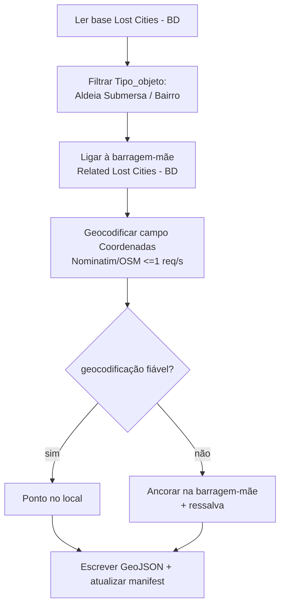

# 06 — Integração com o Notion

Cada barragem do mapa pode ligar-se a uma **página pública do Notion** com
fotos e mais informação. Há **duas** leituras, mas **uma só base**
(`NOTION_DATABASE_ID`), distinguidas pelo campo **`Tipo_objeto`**:

| Leitura | Script | `Tipo_objeto` | Saída |
| --- | --- | --- | --- |
| Páginas de barragem | `fetch_notion.py` | `barragem` | `data/notion.json` |
| Investigação | `fetch_lost_cities.py` | `Aldeia Submersa`, `Bairro` | `data/submersos_notion.geojson`, `data/bairros_notion.geojson` |

## 1. Ligar barragens (base de barragens)

### Lado do Notion

1. A **base única** (a mesma que tem as aldeias/bairros), com uma página por
   barragem e `Tipo_objeto` = `barragem`.
2. Propriedade de texto **`OSM`** — onde se cola o ID (`ID Mapa`, o nome antigo,
   continua a ser aceite).
3. (Opcional) **`Resumo`** (texto) e **`Foto`** (URL externa).

O ID a colar é o **`dam_id`** (`tipo/id`, ex. `way/123456`), obtido no mapa com
o botão **"Copiar ID"** da ficha. Também se pode colar o **link completo do
OSM**; o script normaliza. Aceita-se o id de uma **barragem** **ou de uma
albufeira** — uma albufeira é traduzida para a barragem associada.

### Ligações manuais (`NOTION_OSM_OVERRIDES`)

Quando o casamento automático não chega — nome ambíguo (duas ou mais barragens
com o mesmo nome), nome sem correspondência, um id que aponta para outra coisa,
ou uma aldeia/bairro sem a barragem-mãe ligada na base — a ligação define-se à
mão em `scripts/config.py` → `NOTION_OSM_OVERRIDES`, com o título da página como
chave:

```python
"Facho/Vareta": "way/1232230351",   # Barragem do Facho II
```

O código `AS `/`BN ` do título, a caixa e os acentos são ignorados na procura. A
ligação manual só é usada quando o automático falha, e **nunca sobrepõe** um
valor que já aponte para uma barragem válida (para não desfazer escolhas feitas
no Notion). Serve as duas leituras: preenche a coluna `OSM` (barragens) e liga
as aldeias/bairros à barragem certa.

### Lado do código (`fetch_notion.py`)

- Consulta a base pela **API oficial** (`POST /v1/databases/{db}/query`),
  paginada a 100.
- **Filtra** pelos registos com `Tipo_objeto` = `barragem` (as aldeias/bairros
  são ignorados aqui e tratados por `fetch_lost_cities.py`).
- Para cada página: lê `OSM` (ou `ID Mapa`), **normaliza** o ID
  (`way 123`, `way/123` ou URL → `way/123`), **resolve** para o `dam_id`
  (barragem diretamente; albufeira → barragem associada) e obtém o título, a
  capa e o `Resumo`.
- Aceita também o **id antigo das áreas** (`2n` / `2n+1`) nas albufeiras e
  barragens-relação, para os valores preenchidos antes de 2026-10-16
  continuarem a ligar à barragem certa (ver `03-modelo-dados.md`).
- `public_url` converte o URL interno em público (`public_url`, ou substitui
  `www.notion.so` por `www.<NOTION_PUBLIC_DOMAIN>`).
- **Regista** no log ids inválidos, ids não encontrados nos dados e
  **conflitos** (dois registos para a mesma barragem → fica o `last_edited`
  mais recente).
- Escreve `data/notion.json` (`{ dam_id: { url, titulo, foto_capa, resumo,
  last_edited } }`).
- **Sem `NOTION_TOKEN`/`NOTION_DATABASE_ID` → sai sem erro** (o site continua a
  funcionar sem links).

```bash
python scripts/fetch_notion.py            # gera data/notion.json
python scripts/fetch_notion.py --dry-run  # só valida
```

### Lado do site

No carregamento, `attachNotion` junta os metadados aos pontos da camada `dams`
(`notion_url`, `notion_titulo`, `notion_foto`, `notion_resumo`). A ficha mostra
a capa (com *fallback* gráfico), o botão **Ver no Notion** e o filtro "Só com
página Notion ★".

> **Fotos:** capas carregadas *no* Notion geram URLs que **expiram (~1 h)**.
> Para fotos estáveis, usa **URLs externas**.

### Configurar a integração e os segredos

1. Cria uma integração em <https://www.notion.so/my-integrations> e copia o
   token (`secret_`/`ntn_`).
2. Partilha a base de dados com a integração (menu **… → Connections**).
3. Copia o **ID da base de dados** (32 caracteres, no URL).
4. No repositório: *Settings → Secrets and variables → Actions* →
   `NOTION_TOKEN` e `NOTION_DATABASE_ID`.

## 2. Investigação "Lost Cities - BD" (`fetch_lost_cities.py`)

Alimenta as camadas **"Povoados submersos"** (`submersos`) e **"Bairros novos"**
(`bairros`). Usa a **mesma base única**, filtrando por `Tipo_objeto` =
*Aldeia Submersa* / *Bairro*.

### Fluxo



- **Fonte**: API do Notion (`NOTION_TOKEN`, `NOTION_DATABASE_ID`) **ou** um
  **export local** (`--from-export PASTA`, ficheiros `.md`).
- **Seleção**: registos com `Tipo_objeto` = *Aldeia Submersa* / *Bairro*.
- **Associação**: cada registo liga-se à sua **barragem-mãe** (campo
  `Related Lost Cities - BD`).
- **Geocodificação**: campo `Coordenadas` (que é **texto** — moradas, nomes de
  barragens, marcos, não lat/lon) geocodificado via Nominatim/OSM, com pausa
  ≤ 1 pedido/s e **cache** em `scripts/geocode_cache.json`.
  - Tipos de resultado fiáveis (dam, village, hamlet, city, river, water…)
    valem como ponto; tipos demasiado genéricos (administrative, country,
    region…) e outros (pub, hotel…) contam como **"duvidosa"**.
- **Fallback**: quando a geocodificação é fraca, o ponto é **ancorado na
  barragem-mãe** e escreve-se a `ressalva` correspondente (visível na ficha).
- Escreve os dois GeoJSON **e** atualiza o `manifest.json` sem depender de
  `shapely`.

```bash
python scripts/fetch_lost_cities.py                     # via Notion API
python scripts/fetch_lost_cities.py --from-export PASTA # export local (.md)
python scripts/fetch_lost_cities.py --dry-run           # não escreve
python scripts/fetch_lost_cities.py --no-geocode        # só usa a cache
python scripts/fetch_lost_cities.py --offline           # sem rede
```

### Propriedades lidas na base "Lost Cities - BD"

`Objeto` (título), `Camadas`, `Coordenadas`, `Data conclusão`, `Data inicial`,
`Localização`, `Notas CR`, `Notas IHP`, `Promotor`, `Rio`, `Ruínas`, `Tipo`,
`Tipo_objeto`, `Arquivos`, `Fotografias`, `Related Lost Cities - BD`.

## 3. Camada curada de povoados submersos

Além do Notion, a camada `submersos` inclui uma lista **curada**
(`data/submersos.geojson`) com casos de fontes históricas. O campo `confianca`
(`confirmado` / `provavel` / `por_verificar`) **colore** os pontos e a ficha
mostra a `ressalva` de cada caso. **Não existe inventário oficial** — é um
levantamento curado, a confirmar caso a caso (coordenadas aproximadas).

## 4. Escrita (opcional): preencher a coluna `OSM`

Além de ler, a API do Notion permite **escrever**. O caso mais direto neste
projeto é preencher uma coluna com o **ID do OSM** (`dam_id`, ex.
`way/107571431`) de cada página. O script `scripts/push_notion_osm.py` faz isso.

### Requisitos

- Integração com as capacidades **"Insert content"** e **"Update content"**
  ativas (sem elas, a API devolve `403 restricted_resource`).
- Base partilhada com a integração (o mesmo que já é preciso para ler).
- `NOTION_TOKEN` e `NOTION_DATABASE_ID` (os mesmos segredos).

### Como identifica cada linha

O Notion não sabe a que barragem do OSM corresponde cada página. O script
resolve por esta ordem:

1. Se a página já tem valor em `OSM` **ou** em `ID Mapa`, usa esse valor.
2. Senão, casa o **título** com o nome das barragens de `data/dams_*.geojson`
   (ignora acentos e prefixos como "Barragem de"). Também usa o **nome da
   albufeira associada** — muitas barragens grandes não têm nome próprio no OSM
   (ex.: o nome está em `Albufeira de Picote`).
3. Se houver mais do que um candidato, tenta **desempatar pelo país** (se a
   base tiver uma propriedade tipo "País").
4. Casos ambíguos ou sem correspondência **não são escritos** — ficam listados
   para revisão.

### Uso

```bash
# 1. Ensaio (não escreve nada) — ver o que faria
python scripts/push_notion_osm.py

# 2. Criar a coluna OSM (se ainda não existir) e escrever
python scripts/push_notion_osm.py --apply --ensure-property

# 3. Guardar o URL completo do OSM em vez do id
python scripts/push_notion_osm.py --apply --value url
```

| Opção | Efeito |
| --- | --- |
| (sem opções) | Ensaio (dry-run) — só mostra propostas |
| `--apply` | Escreve mesmo |
| `--ensure-property` | Cria a propriedade `OSM` (tipo `rich_text` ou `url`) se não existir |
| `--value id\|url` | Guarda `way/107571431` (predefinido) ou `https://www.openstreetmap.org/way/107571431` |

Em ambos os modos (ensaio e escrita) escreve sempre um **relatório para
revisão** em `exports/notion_osm_propostas.csv` (colunas `Pagina`, `ID_OSM`,
`Estado`, `Nota`), com o que foi/será preenchido, o que ficou **ambíguo** e o
que ficou **sem correspondência**.

### Cuidados

- **Não há upsert** no Notion: o script só **atualiza** páginas existentes
  (não cria páginas novas).
- **Rate limit** ~3 pedidos/s — o script faz uma pausa entre escritas.
- **Efeitos reais:** `--apply` altera a base. Corre sempre o ensaio primeiro.
- **Tipo da propriedade:** se a coluna `OSM` for criada à mão, tem de ser do
  tipo certo (`rich_text` para o id, `url` para o URL); se já existir com outro
  tipo, ajusta o `--value` em conformidade.

> **Nota:** o mesmo padrão (criar/atualizar propriedades) pode servir para
escrever de volta campos calculados pelo pipeline (`uso`, altura, área da
 albufeira, coordenadas) — ver a discussão em [02 — Pipeline](02-pipeline-dados.md).

## 5. Privacidade

- O export do Notion (`notion/`) contém notas de investigação e ligações
  pessoais — está no `.gitignore` e **não** é publicado.
- Só os GeoJSON derivados (em `data/`) vão para o site.
- **Coordenadas**: o campo `Coordenadas` é texto; todas as posições devem ser
  revistas. O ideal é acrescentar colunas `Latitude`/`Longitude` à base.

## 6. Limitações conhecidas

- Só funciona com integração criada **e** base partilhada com ela.
- Capas carregadas no Notion expiram (~1 h).
- IDs inválidos/duplicados são apenas registados no log (não bloqueiam).
- A geocodificação é sujeita à política do Nominatim (≤ 1 pedido/s) e à
  qualidade do texto de origem.
